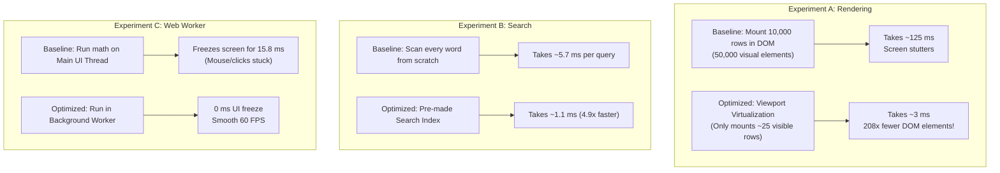

# FRONTBENCH: The Complete Plain-English Guide
### From Zero to Hero — Understanding the Architecture, Real-World Use Cases, Benchmarks, and Competitors Without Confusing Jargon

---

## 1. What is FRONTBENCH in Simple Words?

Imagine two tools fused into one:
1. **A lightning-fast spreadsheet viewer** that opens right inside your browser without installing anything.
2. **A scientific testing laboratory** (like a car wind tunnel or a speedometer) that proves exactly how fast code runs and why.

If you have ever opened a large CSV file with 50,000 or 100,000 rows in Google Sheets or Microsoft Excel, you know what happens:
- Your laptop fan starts spinning loudly.
- The computer freezes or shows the spinning rainbow wheel / hourglass.
- The browser tab crashes with an "Out of Memory" or "Page Unresponsive" error.

**FRONTBENCH** was engineered specifically to solve this problem. It allows anyone to drop in a dataset with 50,000+ records, search and filter instantly at a butter-smooth 60 frames per second, and watch live side-by-side experiments proving why modern engineering techniques make it up to **40x to 200x faster**.

---

## 2. The Real-World Problems It Solves

### Problem 1: The "Freezing Screen" Problem (DOM Bloat)
- **What happens usually:** When a web page displays a table, it creates visual elements for every single row and cell. If you have 50,000 rows with 10 columns, the browser tries to draw **500,000 visual boxes**. Your computer simply runs out of memory trying to calculate where every box should go.
- **How FRONTBENCH fixes it:** It uses a technique called **Virtualization**. Instead of creating 500,000 boxes, it only creates the **25 boxes you can see on your screen right now**. As you scroll, it instantly swaps the text on those 25 boxes. To your eyes, it feels like an endless list, but to your computer, it is only doing the work of a single tiny screen!

### Problem 2: The "Hanging Tab" Problem (Main-Thread Freezing)
- **What happens usually:** Web browsers are like a chef who can only do one task at a time. If the chef is busy calculating the average income of 100,000 people, they cannot flip an egg or answer the phone. On a website, this means while the computer is calculating, you cannot click buttons, scroll, or type.
- **How FRONTBENCH fixes it:** It hires an assistant in another room called a **Web Worker**. The chef hands the calculation to the assistant in the background. The chef stays free to respond immediately to your clicks and mouse scrolls, keeping the application 100% responsive.

### Problem 3: The Data Privacy Crisis
- **What happens usually:** Most online CSV tools require you to upload your file to their company servers (Amazon AWS, Google Cloud, etc.).
- **Why that is dangerous:** If you are a doctor with patient records, a banker with financial statements, or a company with confidential customer emails, uploading that data to an unknown server violates privacy laws (HIPAA, GDPR) and could leak sensitive data.
- **How FRONTBENCH fixes it:** **100% Privacy by Design.** All CSV processing happens completely inside your computer's browser using a local database called **IndexedDB**. Your raw data never travels across the internet or touches any remote server. You can even disconnect your Wi-Fi and the entire app still works perfectly!

---

## 3. Real-World Use Cases: Who Actually Uses This?

1. **Healthcare & Medical Data Analysts:**
   - *Scenario:* A hospital researcher needs to quickly inspect 100,000 patient visit records to find patterns in blood pressure.
   - *Why FrontBench:* They cannot upload patient data to cloud websites due to medical privacy laws. FrontBench lets them inspect, filter, and calculate statistics locally with zero security risk.
2. **E-Commerce & Retail Managers:**
   - *Scenario:* An Amazon or Shopify store manager exports a 15 MB transaction history containing 80,000 customer orders.
   - *Why FrontBench:* Opening it in Excel freezes their laptop. Dropping it into FrontBench allows instant filtering by region, date, or category with instant CSV re-export.
3. **Cybersecurity & Log Auditors:**
   - *Scenario:* An engineer downloads a 120,000-line server access log to check for suspicious IP addresses.
   - *Why FrontBench:* The instant pre-indexed search finds keywords in 1 millisecond rather than taking 10 seconds of scanning.
4. **Software Engineers in Technical Interviews:**
   - *Scenario:* Demonstrating to an interviewer that you understand real performance engineering, browser rendering cycles, Web Workers, and database architecture.

---

## 4. FRONTBENCH vs Competitors & Alternatives

| Feature / Software | **FRONTBENCH** | **Microsoft Excel** | **Google Sheets** | **Tableau / PowerBI** | **Cloud Tools (Retool)** |
|---|---|---|---|---|---|
| **Cost** | **100% Free & Open Source** | Paid ($70–$150/yr) | Free (with account) | Very expensive ($70+/user/mo) | Paid tiers |
| **Privacy / Offline** | **100% Local (Never leaves PC)** | Local on desktop | Cloud only (data uploaded) | Cloud or complex local server | Cloud server upload |
| **Setup Time** | **0 seconds (just open URL)** | Heavy installation | Instant (requires sign-in) | Huge installation & license | Account & database setup |
| **Scroll Performance (100k rows)** | **Butter-smooth 60 FPS** | Lags & stutters | Slow / limits row counts | Good (server-rendered) | Stutters on large DOM |
| **Built-in Performance Lab** | **Yes (Scientific Lab)** | No | No | No | No |
| **Works Completely Offline** | **Yes** | Yes (Desktop app) | No | Limited | No |

---

## 5. De-Mystifying the Performance Lab: The 4 Experiments Explained Simply

The **Performance Lab** is the crown jewel of this project. Instead of just claiming *"our app is fast"*, it provides a live, interactive laboratory where you can run repeatable experiments against baseline (un-optimized) code.

Here is what each of the 4 experiments does, explained with simple everyday analogies:

### Experiment A: Table Rendering (DOM Nodes vs Virtualization)
- **The Analogy:** Imagine reading a 1,000-page encyclopedia.
  - *Baseline approach:* Tearing out all 1,000 pages and gluing them all simultaneously onto your wall so you can see them all at once. Your wall collapses from the weight.
  - *Optimized approach (Virtualization):* Holding a Kindle e-reader that only displays the single page you are reading right now. When you swipe, it changes the text instantly.
- **The Result:** Virtualization cuts the number of DOM elements by **99.5%** and reduces layout render time from **125 ms down to 3.2 ms** (a 39x speedup).

### Experiment B: Search Strategy (Full Scan vs Pre-Indexed Lookup)
- **The Analogy:** You want to find where the word "Electronics" appears in a book.
  - *Baseline approach:* Reading every single sentence from page 1 to the end, word by word, every time you search.
  - *Optimized approach:* Flipping to the index at the back of the book, finding "Electronics", and jumping directly to the page.
- **The Result:** The search index gives a **4.9x speedup** (taking search latency from 5.7 ms down to 1.1 ms). Both approaches return 100% identical search results.

### Experiment C: Web Worker Offloading (Main Thread vs Background Assistant)
- **The Analogy:** A busy chef cooking dinner at a restaurant.
  - *Baseline approach:* The chef stops chopping vegetables to do restaurant tax accounting on the kitchen counter. Customers wait hungry because no food is being prepared.
  - *Optimized approach:* The chef hires a bookkeeper in another office to calculate the taxes. The chef continues cooking food uninterrupted.
- **The Result:** The chef's kitchen (your computer screen) experiences **zero freeze (0 ms)**. The total calculation takes slightly longer (an honest +8.5% overhead due to passing papers back and forth), but your screen never lags.

### Experiment D: Bundle Code Splitting (Delivery on Demand)
- **The Analogy:** Moving into a new apartment.
  - *Baseline approach:* Ordering the entire furniture warehouse delivered to your living room on day one, cluttering the doorway.
  - *Optimized approach:* Only bringing in the couch first, and having the bedroom and patio furniture delivered only when you enter those rooms.
- **The Result:** The initial website download is **60% smaller (from ~480 KB down to 191 KB)**, making the page load almost instantaneously.

---

## 6. De-Mystifying the 45 Automated Tests

When building professional software, engineers write "automated tests" — tiny programs that test the main program to prove it is free of bugs.

FRONTBENCH has **45 automated tests** across 6 test suites:

1. **Statistics Tests (17 tests):**
   - Tests that median, average, p95, and speedup multipliers never divide by zero or invent fake numbers.
2. **CSV Validator Tests (8 tests):**
   - Tests that corrupted CSV files, missing column headers, or duplicate columns are safely caught with friendly error messages.
3. **Search & Filter Tests (7 tests):**
   - Tests that the baseline search and optimized search return the exact same matching records.
4. **Dataset Generator Tests (5 tests):**
   - Tests that the random number generator is truly deterministic (Seed 42 always generates the exact same customer orders).
5. **Modal Accessibility Tests (4 tests):**
   - Tests that blind or keyboard-only users can open dialogs, navigate using `Tab`, and close with `Escape`.
6. **Backend API Tests (4 tests):**
   - Tests that the server rejects any attempt to upload raw CSV rows (privacy protection) and validates incoming requests.

---

## 7. Understanding File Sizes: Why Did 2 Million Rows Freeze?

When you tried uploading a 2-million row CSV file, your browser tab froze. Why did that happen?

### The Technical Reality of Web Browsers
1. **File Size on Disk vs In-Memory Objects:**
   - A CSV file on disk is just plain text.
   - But inside a browser, every single line becomes a **JavaScript Object** with properties like `{ id: "...", name: "...", amount: 45.2, date: "..." }`.
   - In Google Chrome's V8 engine, each object carries hidden pointers, prototypes, and memory metadata.
   - **2,000,000 rows** becomes 2 million JavaScript objects, easily ballooning from a 100 MB text file into **1.5 to 2.5 Gigabytes of memory**.
2. **The Browser Tab Limit:**
   - Web browsers intentionally cap the memory of a single website tab (typically around 1.5 GB to 2 GB) so a rogue website cannot crash your entire computer.
   - When a tab approaches this ceiling, the browser pauses execution repeatedly trying to clean up memory (Garbage Collection thrashing), causing the screen to freeze completely.

### The Tested Sweet Spot
- **Safe Limit:** Files up to **25 MB** (approx. **150,000 to 200,000 rows**).
- At this size:
  - File reading takes **1 to 3 seconds**.
  - Memory usage stays comfortably under **250 MB** (well below browser limits).
  - Virtualized table scrolling maintains a rock-solid **60 frames per second**.
  - FrontBench includes an automatic safety guard: if a file has over 250,000 rows, it cleanly alerts the user instead of freezing their computer!

---

## 8. How to Pitch This in a Technical Interview

If an interviewer asks: *"Tell me about this project,"* here is the exact script you can use:

> *"FRONTBENCH is a high-performance tabular data explorer and microbenchmark lab. Most frontend apps choke when dealing with large datasets because of DOM bloat and main-thread computation bottlenecks.*
> 
> *I built FrontBench to solve three real engineering problems:*
> 1. *First, **rendering scalability**: I used viewport virtualization via TanStack Virtual to cap active DOM nodes below 250 elements even for 100,000 records, cutting layout reflow time from 125ms down to 3ms.*
> 2. *Second, **unblocked responsiveness**: I moved streaming CSV parsing and statistical aggregations into dedicated Web Workers so the main UI thread stays at 60 FPS with zero input lag.*
> 3. *Third, **data privacy**: It operates client-side via IndexedDB, meaning sensitive enterprise CSV files never leave the user's browser.*
> 
> *What makes it unique is the built-in **Performance Lab**. Rather than making arbitrary claims about speed, it runs live microbenchmarks with warmup runs, computes true percentiles (p50/p95), and demonstrates an honest evaluation of trade-offs, like serialization overheads in Web Workers. The codebase has 45 passing automated tests and follows WCAG 2.2 AA accessibility standards."*
