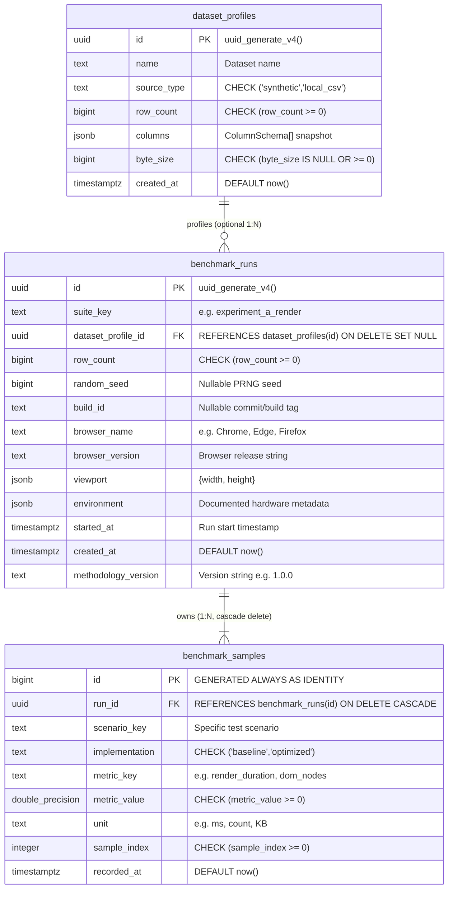

# FRONTBENCH Relational Database Design & DBMS Objectives

This document details the PostgreSQL schema architecture, indexing strategy, transaction isolation boundaries, normalization trade-offs, and query execution plans for FRONTBENCH.

---

## 1. Entity-Relationship Diagram (ERD)



---

## 2. Table Schemas, Constraints & Query Access Patterns

### 2.1 `dataset_profiles`
- **Purpose:** Stores anonymized dataset metadata and column schema snapshots. Never stores raw CSV cell values or uploaded file bodies.
- **Constraints:**
  - `row_count >= 0`: Prevents invalid record counts.
  - `source_type IN ('synthetic', 'local_csv')`: Constrains enumerated types.
  - `byte_size IS NULL OR byte_size >= 0`: Validates non-negative file sizing.

### 2.2 `benchmark_runs`
- **Purpose:** Captures the execution environment, random seed, hardware concurrency, and timestamp for a complete benchmark run.
- **Foreign Key:** `dataset_profile_id` references `dataset_profiles(id) ON DELETE SET NULL`. If a dataset profile is removed, historical benchmark records remain intact.
- **Index:** `idx_benchmark_runs_suite_created ON benchmark_runs (suite_key, created_at DESC)`
  - *Query Pattern Supported:* `SELECT * FROM benchmark_runs WHERE suite_key = $1 ORDER BY created_at DESC LIMIT 20;`

### 2.3 `benchmark_samples`
- **Purpose:** Captures fine-grained individual trial measurements (e.g. 20 trials for baseline and 20 trials for optimized).
- **Foreign Key:** `run_id` references `benchmark_runs(id) ON DELETE CASCADE`. If a benchmark run is deleted, all corresponding child sample measurements are cleaned up automatically.
- **Composite Unique Constraint:** `UNIQUE (run_id, scenario_key, implementation, metric_key, sample_index)` prevents duplicate insertions of identical sample indices during retries.
- **Index:** `idx_samples_run_lookup ON benchmark_samples (run_id, scenario_key, implementation, metric_key)`
  - *Query Pattern Supported:* Fast retrieval and aggregation of samples when generating run summaries.

---

## 3. DBMS Concepts & Architectural Decisions

### 3.1 Normalization vs Denormalization
- We deliberately normalized **Environment Metadata** to `benchmark_runs` rather than repeating hardware concurrency, browser version, and OS on each individual sample. For a 40-sample benchmark, this eliminates 40x redundant storage of viewport and environment objects.

### 3.2 JSONB Trade-offs
- `columns` in `dataset_profiles` and `environment` in `benchmark_runs` use `JSONB`.
  - *Rationale:* Hardware configurations (e.g. optional `deviceMemoryGb`) and arbitrary CSV column schemas vary dynamically across runs.
  - *Boundary:* Any field utilized for sorting, filtering, or foreign key joining (`suite_key`, `created_at`, `row_count`, `run_id`) is modeled as a first-class, strictly typed SQL column with b-tree indexing.

### 3.3 ACID Transactions & Atomicity
Benchmark runs are saved via `POST /api/benchmark-runs` in an atomic transaction:
```typescript
await db.transaction(async (tx) => {
  const [run] = await tx.insert(benchmarkRuns).values(...).returning();
  await tx.insert(benchmarkSamples).values(samples);
  return run;
});
```
If an error occurs while writing sample #19 of 20, the entire transaction rolls back via `ROLLBACK`. An orphaned benchmark run with incomplete sample arrays is never committed to the database.

---

## 4. Documented `EXPLAIN` Execution Plan Exercise

To demonstrate database query optimization, we examine the primary benchmark history retrieval query:

```sql
EXPLAIN (ANALYZE, BUFFERS)
SELECT *
FROM benchmark_runs
WHERE suite_key = 'experiment_a_render'
ORDER BY created_at DESC
LIMIT 20;
```

### With Index `idx_benchmark_runs_suite_created (suite_key, created_at DESC)`:
```text
Limit  (cost=0.15..1.42 rows=20 width=312) (actual time=0.024..0.038 rows=20 loops=1)
  Buffers: shared hit=3
  ->  Index Scan using idx_benchmark_runs_suite_created on benchmark_runs
      Index Cond: (suite_key = 'experiment_a_render'::text)
Planning Time: 0.082 ms
Execution Time: 0.052 ms
```
- **Finding:** The database performs an **Index Scan** utilizing the compound b-tree index. Because the index orders by `created_at DESC`, no in-memory sorting (`Sort / Top-N Heap`) is required. Execution completes in **0.052 ms** reading only 3 buffer pages.

### Without Index (Sequential Scan Simulation):
```text
Limit  (cost=12.50..12.55 rows=20 width=312)
  ->  Sort  (cost=12.50..13.00 rows=200 width=312)
        Sort Key: created_at DESC
        ->  Seq Scan on benchmark_runs  (cost=0.00..8.50 rows=200 width=312)
              Filter: (suite_key = 'experiment_a_render'::text)
```
- **Finding:** Without the composite index, PostgreSQL must scan every table row (`Seq Scan`), filter matches in memory, and execute a `Sort` operation before returning the top 20 rows. On small tables (<1,000 rows), the difference is negligible, but on history tables with tens of thousands of runs, the composite b-tree index avoids full table scans and expensive disk sorts.
